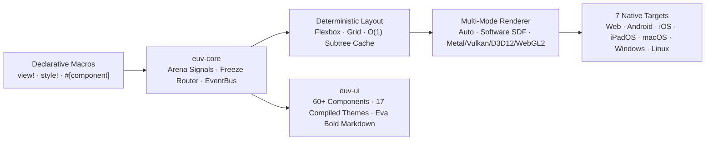

<div align="center">

# euv


**High-Performance Cross-Platform Native UI Framework, 3D Engine & Markdown Studio for Pure Rust**

_Zero WebView · Zero Virtual DOM · Direct OS APIs · 7 Target Platforms · Bit-Identical Rendering_

[](https://crates.io/crates/euv)
[](https://crates.io/crates/euv)
[](https://docs.rs/euv)
[](https://github.com/euv-dev/euv/actions)
[](./LICENSE)
[](https://www.rust-lang.org)

[API Docs](https://docs.rs/euv/latest/) · [Guide](./docs/docs/en/guide/getting-started.md) · [Component Catalog](./docs/docs/en/components/README.md) · [Markdown & Eva Theme Showcase](./docs/docs/en/guide/markdown-syntax.md) · [Agent Engineering Rules](./AGENTS.md)

</div>

---

## Overview

**euv** is a full-stack native Rust UI framework designed for production desktop, mobile, tablet, and WebAssembly applications. Rather than wrapping a browser engine or diffing a virtual DOM, `euv` compiles declarative Rust macros directly into a flat retained scene graph powered by fine-grained push-pull reactivity, deterministic Flexbox/Grid layout, native OS typography, and a unified CPU/GPU/Hybrid rendering pipeline.



---

## Key Capabilities

| Pillar                                                          | Highlights                                                                                                                                                                                                                                                                                                                                                                                        |
| :-------------------------------------------------------------- | :------------------------------------------------------------------------------------------------------------------------------------------------------------------------------------------------------------------------------------------------------------------------------------------------------------------------------------------------------------------------------------------------ |
| **7 Native Platforms (Zero WebView)**                           | Direct OS surfaces across **Web** (WASM Canvas2D/WebGPU/WebGL2), **Android** (NDK `ANativeWindow` + Vulkan/GLES + Skia Fonts), **iOS & iPadOS** (`libobjc` UIKit + Metal + SafeArea + Pencil), **macOS** (AppKit + CoreText + Metal), **Windows** (Win32 + GDI + D3D12), and **Linux** (`dlopen` Wayland/X11 + FreeType + Vulkan).                                                                |
| **Zero-VDOM Declarative Macros + IDE Go-to-Definition**         | Zero-context `view!`, newline-separated `style!` (no `;`), `#[component(retention = Freeze)]`, `#[event]`, `#[global_state_store]`, `local_state!`, `global_state!`, `emit!`, `on_event!`. Built-in tags and properties resolve directly to `euv::view_elements` / `euv::style_props`, and custom components jump straight to their struct definitions in rust-analyzer.                          |
| **Fine-Grained Push-Pull Reactivity & Freeze Routing**          | Generation-indexed arena `Signal`, `Memo`, `Effect`, `Selector`, `Scope`, and `batch`. Inactive pages default to `PageRetention::Freeze` — suspending effects and embedded 2D/3D engines at 0% CPU while coalescing cross-page writes for an atomic flush upon resume.                                                                                                                            |
| **Native Typography & Exact Input Caret**                       | OS-native proportional, monospace, bold, and italic glyph rasterization (CoreText, Android Skia Paint JNI, FreeType, Win32 GDI, Web Canvas2D) with exact glyph-advance `DrawCommand::TextCaret` alignment and zero text overflow across `360px` to `4K`.                                                                                                                                          |
| **`euv-ui` Design System (60+ Components · 17 Themes)**         | Zero-CSS compile-time Light & Dark tokens across 17 presets (Shadcn, Cupertino, Material, Linear, Geist, Stripe, etc.), Twitter/X-style `EuvBottomNav` + horizontal swipe routing, live navbar FPS telemetry, zero-overshoot gesture-draggable `EuvDrawer` & `EuvSheet`, unified 1:1 width dropdowns, and full GFM `EuvMarkdown` + VS Code **Eva Light Bold** / **Eva Dark Bold** `EuvCodeBlock`. |
| **Real-Time 2D/3D Engine & Dynamic OTA WASM**                   | Fixed-timestep 2D physics, BVH ray-traced 3D open-world renderer (`FullPathTracedGi`, `.OBJ`/`.glTF` import), pure-Rust Media Suite (Image, SVG, GIF, LIVE Photo, Video, WAV Audio, PDF, HTML5), and cryptographically signed partial/global `.wasm` hot-swap slots.                                                                                                                              |
| **Developer Tooling (`euv-cli`, `euv-docs`, `euv-automation`)** | `euv fmt` macro indentation formatter, zero-JS static documentation generator (`euv docs`), live SSE hot-reload dev server (`euv dev`), and dev-only AI Schema v1 automation bridge (stripped to 0 bytes in release builds).                                                                                                                                                                      |

---

## Cross-Platform Target Matrix

| Platform         | Target Triple              | Window & Surface API                     | Native Font Engine             | GPU Shader Backend     |
| :--------------- | :------------------------- | :--------------------------------------- | :----------------------------- | :--------------------- |
| **Web**          | `wasm32-unknown-unknown`   | Zero-JS HTML5 Canvas / WebGPU / WebGL2   | Web Canvas2D                   | WGSL / GLSL ES 3.0     |
| **Android**      | `aarch64-linux-android`    | NDK `ANativeWindow` + JNI                | Android Skia Paint / FreeType  | SPIR-V / GLES          |
| **iOS / iPadOS** | `aarch64-apple-ios`        | Direct `libobjc` UIKit + `CAMetalLayer`  | CoreText + CoreGraphics        | MSL (Metal)            |
| **macOS**        | `aarch64-apple-darwin`     | Direct `libobjc` AppKit + `CAMetalLayer` | CoreText + CoreGraphics        | MSL (Metal)            |
| **Windows**      | `x86_64-pc-windows-msvc`   | Direct Win32 `user32` / `gdi32`          | Win32 GDI (`GGO_GRAY8_BITMAP`) | HLSL (Direct3D 12)     |
| **Linux**        | `x86_64-unknown-linux-gnu` | Runtime `dlopen` Wayland & X11           | FreeType + Fontconfig          | SPIR-V (Vulkan) / GLSL |

---

## Quick Start

### 1. Add Dependencies

```shell
cargo add euv euv-ui
```

### 2. Build a Declarative Reactive Component

Follow the clean macro authoring pattern (see [AGENTS.md](./AGENTS.md)): define handlers and reactive closures as sibling `let` bindings or outer helper `fn`s, and write one style rule per line inside `style!`.

```rust
use {euv::*, euv_ui::*};

#[derive(Clone)]
pub struct CounterCard {
    tokens: ThemeTokens,
}

#[component(retention = Freeze)]
impl CounterCard {
    fn render(&self) -> NodeId {
        let count: LocalState<i32> = local_state!(0);
        let tokens: ThemeTokens = self.tokens;
        let p: ThemePalette = tokens.get_palette();
        let g: ThemeGeometry = tokens.get_geometry();

        let container_style: Style = style! {
            FlexDirection::Column
            Overflow::Hidden
            width: Length::Percent(100.0)
            padding: Edges::all(SPACE_XL)
            gap: SPACE_MD
            background: p.get_card()
            border: (g.get_border_width(), p.get_border())
            radius: g.get_radius_lg()
        };

        let count_text = move || -> String { format!("Count: {}", count.get()) };
        let on_inc = move |_: &UiEvent| {
            let _: bool = count.update(|v: &mut i32| *v += 1);
        };

        view! {
            view {
                style: container_style
                text {
                    width: Length::Percent(100.0)
                    font_size: 20.0
                    font_weight: FontWeight::Bold
                    color: p.get_foreground()
                    { count_text }
                }
                EuvButton("Increment (+1)".to_string(), tokens) {
                    on_click: on_inc
                }
            }
        }
    }
}
```

---

## Verified Performance Highlights

Reproducible benchmarks live in [`euv-performance`](./performance/README.md) and interactively inside the showcase Stress Lab (`cargo run -p euv-performance`):

| Benchmark                                 |  Measured Result  | Notes                                   |
| :---------------------------------------- | :---------------: | :-------------------------------------- |
| Reactive diamond signal propagation       |    **~660 ns**    | Glitch-free topological push-pull       |
| `Selector` O(1) active row switch         |    **~217 ns**    | Only previous & next keys notified      |
| Retained layout clean-subtree cache       |    **~23 ns**     | Skips unchanged subtrees in O(1)        |
| 100,000-row virtualized scroll frame      |   **< 0.2 ms**    | Mounts only visible viewport + overscan |
| 240Hz hit-testing & pointer tap stability | **0.00 px drift** | Zero unintended scroll drift on tap     |

---

## Workspace Architecture

| Crate                 | Path                                      | Responsibility                                                                                                                |
| :-------------------- | :---------------------------------------- | :---------------------------------------------------------------------------------------------------------------------------- |
| **`euv`**             | [`src/`](./src/)                          | Umbrella crate re-exporting core runtime & procedural macros                                                                  |
| **`euv-core`**        | [`core/`](./core/README.md)               | Reactive arena, Flexbox/Grid layout, retained scene graph, multi-mode renderer, 2D/3D engine, media codecs, OS backends       |
| **`euv-macros`**      | [`macros/`](./macros/README.md)           | Zero-context `view!`, newline `style!`, `tokens!`, `watch!`, `computed!`, `#[component]`, `#[event]`, `#[global_state_store]` |
| **`euv-ui`**          | [`ui/`](./ui/README.md)                   | 60+ adaptive components, 17 zero-CSS themes, Freeze router, gesture drawers, Eva Bold Markdown & code studio                  |
| **`euv-cli`**         | [`cli/`](./cli/README.md)                 | `euv doctor`, `euv build`, `euv dev`, `euv docs`, `euv fmt`, `euv new`                                                        |
| **`euv-docs`**        | [`docs/`](./docs/README.md)               | Zero-JS static documentation site generator with Eva Bold syntax highlighting & live search                                   |
| **`euv-automation`**  | [`automation/`](./automation/)            | Headless UI automator & dev-only AI Schema v1 bridge (0 bytes in release)                                                     |
| **`euv-performance`** | [`performance/`](./performance/README.md) | Reproducible CPU, layout, reactivity, list & 3D benchmark harness                                                             |
| **`euv-example`**     | [`example/`](./example/README.md)         | Full 15-route cross-platform showcase app (Bottom Nav + Swipe Routing + 3D RT + Stress Lab + Markdown Studio)                 |

---

## Developer Workflow & Commands

```shell
# Verify all 7 target toolchains & connected simulators/emulators
cargo run -p euv-cli -- doctor

# Format workspace Rust code and normalize all view!/style!/tokens! macro blocks
cargo run -p euv-cli -- fmt
cargo fmt --all

# Run the full test suite and zero-warning clippy gate
cargo clippy --all-features --workspace --all-targets -- -D warnings
cargo test --all-features --workspace

# Run interactive showcase, static docs generator, or benchmark suite
cargo run -p euv-example -- --headless --software
cargo run -p euv-docs -- --generate docs/docs/en target/docs-preview
cargo run -p euv-performance

# Platform build & packaging scripts (see scripts/README.md)
./scripts/build/build-web.sh
./scripts/build/build-theme-variants.sh
./scripts/build/build-android-apk.sh --install
./scripts/build/build-ios-sim.sh
```

---

## Documentation & Engineering Standards

- **[Getting Started](./docs/docs/en/guide/getting-started.md)** — Install, compose components, and target all 7 platforms.
- **[Architecture & Backends](./docs/docs/en/guide/architecture.md)** — Scene tree, Freeze routing, and render modes.
- **[Native GPU Drivers & System Fonts](./docs/docs/en/guide/native-gpu-and-fonts.md)** — Metal/Vulkan/D3D12/WebGL2 and OS glyph rasterization.
- **[Markdown Syntax & Eva Theme Showcase](./docs/docs/en/guide/markdown-syntax.md)** — Full GFM + VS Code Eva Light/Dark Bold verification page.
- **[Workspace Engineering Guidelines](./AGENTS.md)** — Mandatory macro authoring, UI gesture/layout, formatting, and Rust module standards.
- **[Scripts Directory](./scripts/README.md)** — Environment setup, cross-platform builds, theme variants, and E2E gates.

## Contributing

Contributions are welcome! Please read [AGENTS.md](./AGENTS.md) and ensure `euv fmt --check`, `cargo fmt --all -- --check`, `cargo clippy --all-features --workspace --all-targets -- -D warnings`, and `cargo test --all-features --workspace` pass before opening a pull request.

## License

This project is licensed under the MIT License. See the [LICENSE](./LICENSE) file for details.

## Contact

For inquiries, please reach out to [root@devhub.vip](mailto:root@devhub.vip).
