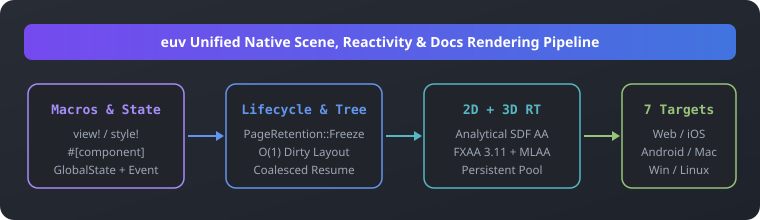

# Markdown Syntax & Eva Theme Showcase

This reference test page covers **100% of supported Markdown, GFM, and `euv-docs` syntax** across both Light Mode (`Eva Light Bold`, `#EBEEF5`) and Dark Mode (`Eva Dark Bold`, `#282C34`)[^eva-theme].

---

## Headings & Custom Anchors {#custom-anchor}

### Heading Level 3 — Section Hierarchy

#### Heading Level 4 — Subsection Details

##### Heading Level 5 — Deep Reference

###### Heading Level 6 — Micro Note

## 中文与 Unicode 锚点导航

Unicode headings generate clean, linkable fragment anchors (`#中文与-unicode-锚点导航`) alongside explicit `{#custom-anchor}` overrides.

---

## Inline Typography & Rich Elements

Standard prose supports **bold emphasis**, _italic emphasis_, ***bold italic combined***, ~~strikethrough edits~~, `inline_code_token()`, <mark>highlighted markers</mark>, keyboard shortcuts like <kbd>Cmd</kbd>+<kbd>K</kbd> or <kbd>Ctrl</kbd>+<kbd>Shift</kbd>+<kbd>P</kbd>, chemical subscripts H<sub>2</sub>O, exponents E = mc<sup>2</sup> / 2<sup>16</sup>, and escaped punctuation such as \*not italic\* and \`not code\`.

Line breaks support both soft wrapping and explicit hard line breaks:
This line starts directly beneath the previous sentence via a trailing two-space hard break.

Hyperlinks work for [internal relative docs](./getting-started.md), [same-page anchors](#custom-anchor), [external links with hover titles](https://www.rust-lang.org "The Rust Programming Language"), automatic URLs like <https://euv.ltpp.vip>, and inline footnotes[^euv-arch].

---

## Lists, Nesting & GFM Task Checklists

### Unordered Nested Lists

- Core Runtime (`euv-core`)
  - Arena-backed `Signal<T>`, `Memo<T>`, `Effect`, `LocalState<T>`, `GlobalState`
  - Typed `EventBus` with `#[event]`, `emit!`, and `on_event!`
    - Automatic disposal on `Scope::dispose()`
    - Atomic coalescing across `PageRetention::Freeze` and `Scope::resume()`
- UI Design System (`euv-ui`)
  - 17 compiled schemes with Light & Dark tokens
  - Native `EuvCodeBlock` & `EuvMarkdown` aligned with VS Code `Eva Light Bold` / `Eva Dark Bold`

### Ordered Lists & Custom Start

1. Parse Markdown + YAML frontmatter via `euv-docs`.
2. Render syntax-highlighted code blocks with line numbers and clipboard Copy.
3. Generate clean URLs, instant client search index, and `sitemap.xml`.

10. Custom start numbering continues cleanly from `10`.
11. Nested items inside ordered steps preserve indentation.

### Interactive GFM Task List

- [x] Standalone `Lifecycle` + `Component` traits and `#[component(retention = Freeze)]`
- [x] Newline-separated `style!` rules (one rule per line, zero semicolons) with IDE Go-to-Definition
- [x] Workspace-wide macro formatter in `euv fmt` with exact compound closure indentation
- [x] Root-page double-back-to-exit bottom toast confirmation
- [x] Zero-overshoot gesture-draggable drawers & bottom sheets
- [ ] Optional user custom theme overrides

---

## Blockquotes & Nested Quotes

> Simple single-paragraph blockquote citing framework design goals.

> Multi-paragraph blockquote demonstrating nested citations.
>
> > Nested second-level quote: *"Zero WebView wrappers — direct native OS surfaces across all 7 platforms."*

---

## GitHub-Style Alerts

> [!NOTE]
> Useful background information: every code block below uses exact VS Code **Eva Light Bold** (`#EBEEF5`) in light mode and **Eva Dark Bold** (`#282C34`) in dark mode.

> [!TIP]
> Click the **Theme** button in the top-right header to toggle between Light and Dark mode and watch the Eva Bold code palette adapt instantaneously.

> [!IMPORTANT]
> Essential architecture rule: inactive pages default to `PageRetention::Freeze`, suspending reactive effects and 3D engines until resumed.

> [!WARNING]
> Always place each declaration inside `style! { ... }` on its own line without trailing semicolons — multiple rules on one line produce a compile-time error.

> [!CAUTION]
> Legacy `Mountable` and `Style::empty()` APIs have been removed; migrate all code to `Component`, `Lifecycle`, and `Style::default()`.

---

## Docs Custom Callout Containers & Disclosures

::: note Note Container
VuePress-style `::: note` containers coexist seamlessly with GitHub `> [!NOTE]` alerts.
:::

::: info Runtime Info
`euv-docs` generates zero external `.js` files while preserving live search, TOC tracking, theme persistence, and Copy buttons.
:::

::: tip Performance Tip
Combine `#[component(retention = Freeze)]` with `local_state!` so returned pages resume in a single atomic flush.
:::

::: warning Layout Warning
Avoid hardcoding fixed pixel widths wider than compact `360px` mobile viewports inside responsive cards.
:::

::: danger Security Rule
Raw `<script>` tags and `javascript:` URLs are automatically neutralized during static HTML generation.
:::

::: details Expandable Custom Container
Inside a `::: details` block you can nest **rich Markdown**, lists, and highlighted code:

```rust
let banner: Signal<String> = global_state!(String = "Ready".to_string());
```

:::

<details>
<summary>Native HTML &lt;details&gt; Disclosure Element</summary>

Native `<details>` and `<summary>` tags also render cleanly with keyboard and pointer toggling in every browser.

</details>

---

## Eva Light Bold & Eva Dark Bold Code Blocks

### Rust (`#[component]`, `style!`, `#[event]`, `view!`)

```rust
#[event]
#[derive(Debug, Data)]
pub struct PulseEvent {
    pub(crate) source: String,
    #[get(type(copy))]
    pub(crate) seq: u32,
}

#[component(retention = Freeze)]
impl DemoPage {
    fn on_freeze(&self, _node: NodeId) {
        emit!(PulseEvent { source: "demo".to_string(), seq: 1 });
    }

    fn render(&self) -> NodeId {
        let count: LocalState<i32> = local_state!(42);
        let card_style: Style = style! {
            AlignItems::Center
            Overflow::Hidden
            width: Length::Percent(100.0)
        };
        let label_text = move || -> String { format!("Count: {}", count.get()) };
        view! {
            column {
                style: card_style
                text { { label_text } }
            }
        }
    }
}
```

### TypeScript

```ts
// Exact VS Code Eva Light Bold / Eva Dark Bold TypeScript colors
interface RenderPipeline {
  readonly target: "metal" | "vulkan" | "webgpu";
  maxFps: number;
  rayTracing: boolean;
}

export function createPipeline(fps: number): RenderPipeline {
  return { target: "metal", maxFps: fps, rayTracing: true };
}
```

### JSON

```json
{
  "theme": "Eva Light Bold / Eva Dark Bold",
  "backgroundLight": "#EBEEF5",
  "backgroundDark": "#282C34",
  "retention": "Freeze",
  "rayTracing": "FullPathTracedGi",
  "maxFps": 144
}
```

### Unified Diff

```diff
@@ -1,4 +1,5 @@
-let style = Style::empty().align(AlignItems::Center).overflow(Overflow::Hidden);
+let style = style! {
+    AlignItems::Center
+    Overflow::Hidden
+};
-impl Mountable for MyPage { fn mount(self, ctx: &mut BuildContext) -> NodeId { ... } }
+#[component(retention = Freeze)]
+impl MyPage { fn render(&self) -> NodeId { view! { ... } } }
```

### Shell & YAML

```bash
# Format all view!/style!/tokens! macros and build docs
euv fmt --check && cargo run -p euv-docs -- --generate docs/docs/en target/docs-preview
```

```yaml
site:
  title: euv-docs
  theme: Eva Bold
  targets: 7
```

---

## GFM Aligned Tables

| Feature                  |    Alignment & Code     |   Status    | Target Latency |
| :----------------------- | :---------------------: | :---------: | -------------: |
| **Fine-Grained Signals** | `Signal<T>` / `Memo<T>` |   Stable    |      `0.30 ms` |
| **Virtual 100k List**    |    `EuvVirtualList`     |   Stable    |      `0.14 ms` |
| **240Hz Hit-Test**       |    Flat `SceneTree`     |   Stable    |      `0.08 ms` |
| **3D BVH Ray Tracing**   |   `FullPathTracedGi`    | Max Quality |      `60+ FPS` |

---

## Definition Lists

`PageRetention::Freeze`
: Suspends reactive effects and embedded 2D/3D engines while keeping the page subtree cached; cross-page writes coalesce and flush once on resume.

`PageRetention::Destroy`
: Tears down the page subtree and disposes its reactive `Scope` immediately upon leaving the route.

`PageRetention::Alive`
: Hides the departed page visually (`Display::None`) while keeping background subscriptions running live.

---

## Math Expressions

Inline complexity notation renders cleanly inside prose, such as $O(n \log n)$ sorting or subpixel Halton jitter $(H_2(i), H_3(i))$:

$$L_o(p, \omega_o) = L_e(p, \omega_o) + \int_{\Omega} f_r(p, \omega_i, \omega_o) L_i(p, \omega_i) (\omega_i \cdot n)\, d\omega_i$$

---

## Embedded Vector Diagram & Media



---

## Footnotes

[^eva-theme]: Token colors extracted directly from VS Code `Eva Light Bold` (`#EBEEF5`) and `Eva Dark Bold` (`#282C34`).
[^euv-arch]: All 7 platforms share one deterministic layout, reactive arena, and rendering pipeline with zero WebView overhead.
